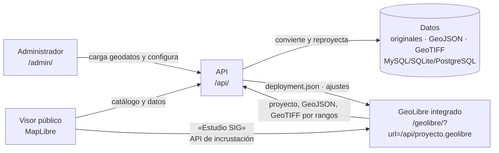

# Geoportal Ambiental — Gobernación de Nariño

Geoportal de la **Secretaría de Ambiente y Desarrollo Sostenible** para publicar,
consultar y descargar la información geográfica ambiental del departamento.
Se construye sobre [GeoLibre](https://github.com/opengeos/GeoLibre) (SIG libre, MIT):
la versión web oficial de GeoLibre se integra en el propio geoportal como
**Estudio SIG**, con las capas publicadas ya cargadas, y desde ahí se usan todas
sus herramientas (edición, estilos, SQL, más de mil herramientas de
geoprocesamiento, 3D, impresión, complementos) en el navegador, sin que los
datos salgan de la infraestructura de la Gobernación.

| Componente | Qué hace | Dónde |
| --- | --- | --- |
| **Visor público** | Interfaz minimalista: el mapa a toda la vista, una tarjeta (búsqueda + capas) y un botón de herramientas. Paleta de comandos (`Ctrl` + `K`), capas por categoría con opacidad y orden, consulta y tabla de atributos, datos propios sin subirlos (archivos, WMS, XYZ), medición, terreno 3D, enlace permanente, insertar el mapa, imprimir, imagen PNG, mapas base y ficha de metadatos | `portal/index.html` · [plan de interfaz](docs/plan-interfaz-minimalista.md) |
| **Estudio SIG** | GeoLibre integrado (mismo origen), configurado desde el administrador y controlado desde el visor | `portal/geolibre/` · [guía](docs/estudio-sig.md) |
| **Catálogo** | Tarjetas de geodatos con búsqueda y filtros | `portal/index.html#catalogo` |
| **Administrador** | Carga de geodatos, ficha de metadatos, simbología, publicación, categorías, usuarios, bitácora y ajustes del Estudio SIG | `portal/admin/` |
| **API** | Ingesta y conversión de formatos, catálogo, datos, proyectos `.geolibre` y política de GeoLibre | `api/` (Python) · `portal/api/` (PHP) |

Todo el sitio tiene **modo oscuro** (automático, claro u oscuro) y sigue los manuales de
identidad visual y de sitios web de la Gobernación.



## Dos ediciones, la misma interfaz

| | **Plesk / hosting PHP** | **Docker / servidor** |
| --- | --- | --- |
| Instalación | Subir la carpeta y completar el **asistente de instalación** (como WordPress) | `docker compose up` o servicio systemd |
| Backend | PHP 8.1+ (`portal/api/`) | Python FastAPI + GDAL (`api/`) |
| Base de datos | **MySQL / MariaDB** | MySQL, PostgreSQL o SQLite |
| Conversión de geodatos | En el navegador del administrador, con validación en el servidor | En el servidor (GDAL) |
| Guía | [Instalación en Plesk](docs/instalacion-plesk.md) | Ver abajo y [arquitectura](docs/arquitectura.md) |

Ambas exponen la misma API (`/api/...`), así que el visor, el catálogo, el administrador y el
Estudio SIG son idénticos.

## Instalación en Plesk (subiendo archivos)

1. Cree una base de datos MySQL en Plesk.
2. Genere el paquete con `scripts/empaquetar-plesk.sh` o descárguelo de *Releases*.
3. Súbalo con el Administrador de archivos y elija «Extraer».
4. Abra `https://su-dominio/geoportal/instalar/` y siga el asistente.
5. En *Administrador → Estudio SIG* pulse **Instalar GeoLibre** (o use el paquete
   `-con-geolibre`, que ya lo trae).

Los detalles, la solución de problemas y la verificación realizada están en
[docs/instalacion-plesk.md](docs/instalacion-plesk.md).

## Inicio rápido (Docker)

```bash
cp .env.example .env
```

Edite `.env`: como mínimo `GEOPORTAL_SECRET_KEY`, `GEOPORTAL_ADMIN_PASSWORD` y,
en un servidor, `GEOPORTAL_PUBLIC_URL`.

```bash
docker compose up -d --build
```

- Geoportal: <http://localhost:8080>
- Administrador: <http://localhost:8080/admin/>
- Documentación de la API: <http://localhost:8080/api/docs>
- Estudio SIG: <http://localhost:8080/#estudio> (instálelo antes en *Administrador → Estudio SIG*)

## Desarrollo sin Docker

```bash
cd api
pip install -r requirements-dev.txt
```

```bash
GEOPORTAL_ADMIN_PASSWORD=Clave-Local-2026 GEOPORTAL_PORTAL_DIR=../portal GEOPORTAL_PUBLIC_URL=http://localhost:8000 uvicorn app.main:app --reload
```

Con `GEOPORTAL_PORTAL_DIR` la API sirve también el sitio estático, así que el
geoportal queda en <http://localhost:8000> y el administrador en
<http://localhost:8000/admin/>.

Pruebas:

```bash
cd api && python -m pytest
```

Pruebas de la edición PHP (necesitan PHP 8.1+ con `pdo_mysql` y un MySQL accesible):

```bash
GP_MYSQL_USER=usuario GP_MYSQL_PASSWORD=clave python -m pytest pruebas/edicion_php
```

## Formatos que acepta el administrador

| Tipo | Formatos | Resultado publicado |
| --- | --- | --- |
| Vector | GeoJSON, Shapefile (`.zip` con `.shp`, `.shx`, `.dbf`, `.prj`), GeoPackage, KML/KMZ, GML, FlatGeobuf, GeoParquet, CSV (lat/lon o WKT) | GeoJSON RFC 7946 en EPSG:4326 |
| Ráster | GeoTIFF/COG, ERDAS IMG, ASCII Grid, JPEG 2000 | Cloud Optimized GeoTIFF (EPSG:3857) + vista previa PNG |

Los sistemas de referencia colombianos (MAGNA-SIRGAS Origen Nacional EPSG:9377,
orígenes Bogotá/Oeste/Este, ESRI:103599, etc.) se detectan y reproyectan
automáticamente. Si el archivo no declara su sistema (Shapefile sin `.prj`, CSV en
metros) el administrador permite indicar el EPSG de origen.

## Documentación

- [Manual del administrador](docs/manual-administrador.md): cómo cargar, documentar, simbolizar y publicar geodatos.
- [Estudio SIG](docs/estudio-sig.md): GeoLibre integrado, instalación, todos sus ajustes, integración con el visor y funciones del visor.
- [Revisión de GeoLibre](docs/revision-geolibre.md) y su [inventario de funciones](docs/anexo-inventario-geolibre.md): qué ofrece GeoLibre y cómo queda cubierto.
- [Plan de implementación](docs/plan-implementacion.md) y [plan de interfaz minimalista](docs/plan-interfaz-minimalista.md): fases, criterios y estado.
- [Arquitectura y despliegue](docs/arquitectura.md): componentes, API, integración con GeoLibre, producción y respaldos.
- [Instalación en Plesk subiendo archivos](docs/instalacion-plesk.md): edición PHP + MySQL con asistente de instalación.
- [Despliegue en Plesk con Docker o systemd](docs/despliegue-plesk.md): edición Python, en dominio, subdominio o subdirectorio.
- [Identidad visual](docs/identidad-visual.md): cómo se aplicaron los manuales de la Gobernación.

## Auditoría de seguridad

El repositorio incluye la skill [`security-audit`](.claude/skills/security-audit/) de Cloudflare
(MIT), revisada y fijada a un commit (ver [`PROCEDENCIA.md`](.claude/skills/security-audit/PROCEDENCIA.md)).
En Claude Code, dentro del repositorio, pida por ejemplo «haz una auditoría de seguridad de este
repositorio». Los informes se escriben fuera del repositorio.

## Licencia

La licencia del código del geoportal la define la Gobernación de Nariño.
GeoLibre es software de terceros con licencia MIT (© Qiusheng Wu y
colaboradores) y se usa sin modificaciones: su compilación web oficial (paquete de
PyPI, verificado con SHA-256) incluye sus licencias en `geolibre/licenses/`. Los
geodatos publicados conservan la licencia indicada en su ficha.
