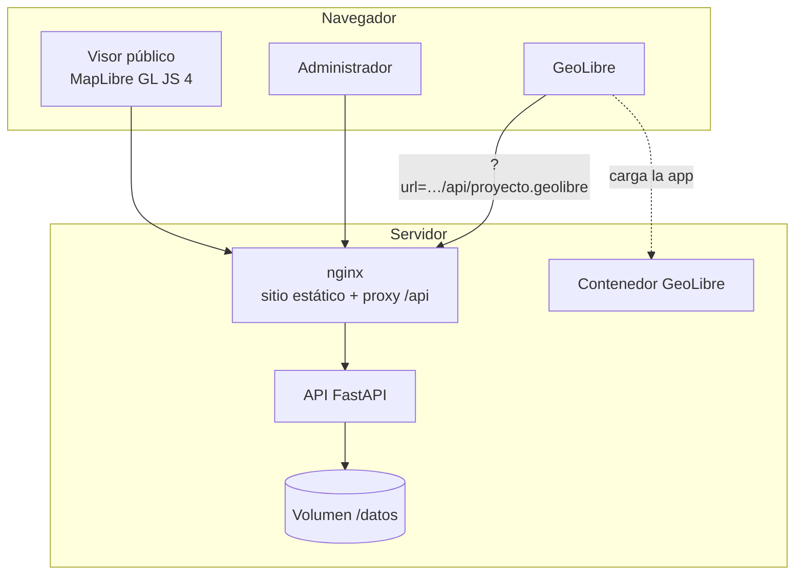

# Arquitectura y despliegue

## Por qué GeoLibre como base

[GeoLibre](https://github.com/opengeos/GeoLibre) es un SIG web libre (MIT) que
lee formatos abiertos y nativos de la nube (GeoJSON, COG, GeoParquet, PMTiles…),
corre el análisis en el navegador y guarda los mapas como proyectos abiertos
`.geolibre`. Lo que **no** hace es alojar ni catalogar datos: «lee los datos de
donde se le indique». El geoportal cubre esa parte:

- un **catálogo administrado** con roles, metadatos y flujo de publicación;
- la **ingesta** que convierte lo que produce la Secretaría (Shapefile en
  MAGNA-SIRGAS, GeoPackage, KML, rásteres) en formatos que GeoLibre y la web
  consumen directamente;
- la **generación de proyectos GeoLibre** a partir del catálogo.

GeoLibre se usa sin modificar su código (imagen oficial
`ghcr.io/opengeos/geolibre`), así las actualizaciones del proyecto se adoptan
cambiando la etiqueta de la imagen.

## Componentes



| Servicio | Imagen | Puerto | Función |
| --- | --- | --- | --- |
| `web` | `nginx:1.27-alpine` | 8080 | Sirve `portal/` y hace proxy de `/api/` |
| `api` | `./api` (Python 3.12) | interno 8000 | Ingesta, catálogo, datos, autenticación, proyectos |
| `geolibre` | `ghcr.io/opengeos/geolibre` | 8081 | SIG web para análisis |

### Almacenamiento (volumen `geodatos` → `/datos`)

```
/datos/
├── geoportal.db          # SQLite: capas, categorías, usuarios, bitácora
├── originales/<id>/      # archivo tal como se cargó (descarga «original»)
├── procesados/<id>/      # datos.geojson | datos.tif + vista_previa.png
└── tmp/                  # área de trabajo de la ingesta
```

Para PostgreSQL defina `GEOPORTAL_DATABASE_URL=postgresql+psycopg://…`; las
tablas se crean al iniciar.

### API

Documentación interactiva en `/api/docs`.

**Pública (solo capas publicadas):**

| Método y ruta | Descripción |
| --- | --- |
| `GET /api/config` | Parámetros del visor y URL de GeoLibre |
| `GET /api/categorias` | Categorías con capas publicadas |
| `GET /api/capas?q=&categoria=&tipo=` | Catálogo con búsqueda |
| `GET /api/capas/{slug}` | Ficha de la capa |
| `GET /api/capas/{slug}/datos.geojson` | Datos vectoriales (EPSG:4326) |
| `GET /api/capas/{slug}/datos.tif` | COG, con soporte de `Range` |
| `GET /api/capas/{slug}/vista-previa.png` | Vista previa del ráster |
| `GET /api/capas/{slug}/descarga[?original=1]` | Descarga |
| `GET /api/capas/{slug}/proyecto.geolibre` | Proyecto GeoLibre de una capa |
| `GET /api/proyecto.geolibre[?categoria=&capas=a,b]` | Proyecto GeoLibre del catálogo |

**Administración (token Bearer):** `POST /api/auth/ingresar`, `GET /api/auth/yo`,
`POST /api/auth/cambiar-clave`, y bajo `/api/admin/`: `resumen`, `capas` (CRUD,
`POST capas` multipart con `archivo` + `metadatos` JSON, `POST capas/{id}/archivo`,
`POST capas/{id}/publicacion?publicar=`, `GET capas/{id}/muestra`),
`categorias`, `usuarios`, `bitacora`.

### Proyectos GeoLibre generados

`api/app/services/geolibre.py` arma el proyecto según el esquema
[`project-format`](https://github.com/opengeos/GeoLibre/blob/main/docs/project-format.md):

- cada **categoría** → carpeta (`layerGroups`), en el orden definido en el
  administrador;
- **vector** → capa `geojson`; hasta `GEOPORTAL_INLINE_MAX_MB` (15 MB) las
  entidades van embebidas en el proyecto (abre sin peticiones extra) y además
  conserva `source.url`; por encima se referencia por URL;
- **ráster** → capa `cog` con la rampa y el reescalado elegidos;
- simbología → `style`; ventana emergente → `popup`; ficha →
  `descriptiveMetadata` (GeoLibre la muestra en *Metadata* y la exporta como
  STAC); `capabilities.export` refleja «permitir descarga»;
- los identificadores son deterministas (UUID v5 del slug), así un proyecto
  guardado sigue reconociendo sus capas.

El enlace usa los parámetros de GeoLibre `?url=<proyecto>&layout=viewer`
(interfaz de solo lectura). El administrador puede quitar `&layout=viewer` para
la interfaz completa.

## Despliegue en producción

1. Servidor Linux con Docker y Docker Compose.
2. Dos nombres DNS con TLS, por ejemplo:
   - `geoportal-ambiental.narino.gov.co` → puerto 8080
   - `visor-sig.narino.gov.co` → puerto 8081
3. `.env`:

   ```ini
   GEOPORTAL_PUBLIC_URL=https://geoportal-ambiental.narino.gov.co
   GEOLIBRE_PUBLIC_URL=https://visor-sig.narino.gov.co
   GEOPORTAL_SECRET_KEY=<openssl rand -base64 48>
   GEOPORTAL_ADMIN_PASSWORD=<clave fuerte>
   GEOPORTAL_API_DOCS=false
   ```

4. `docker compose up -d --build`.
5. Proxy inverso con TLS delante (nginx/Caddy/Traefik institucional). Ajuste
   `client_max_body_size` y los tiempos de espera si cambia el límite de carga.

Requisitos que impone GeoLibre:

- su política de seguridad (CSP) solo permite conectarse a orígenes `https:`
  (más `localhost` en desarrollo), por lo que **el geoportal debe publicarse con
  HTTPS**;
- descarga proyecto y datos desde otro origen: la API ya responde con CORS para
  `GEOLIBRE_PUBLIC_URL` (y expone `Content-Range`/`Accept-Ranges` para las COG).

### Configuración de GeoLibre

`geolibre/deployment.json` fija la política de la instancia (nivel de interfaz
*intermedio*, sin mapas base regionales). El `docker-compose.yml` además
desactiva el servicio de compartir proyectos públicos, la conexión GeoLens y el
*sidecar* de Python (`GEOLIBRE_DISABLE_SIDECAR=1`; póngalo en `0` si necesita la
caja de herramientas Whitebox del lado del servidor). Ver
[self-hosting](https://github.com/opengeos/GeoLibre/blob/main/docs/self-hosting.md)
y [deployment-policy](https://github.com/opengeos/GeoLibre/blob/main/docs/deployment-policy.md).

### Respaldos

Respalde el volumen completo (base de datos y archivos):

```bash
docker run --rm -v app-ambiente_geodatos:/datos -v "$PWD":/respaldo alpine tar czf /respaldo/geodatos-$(date +%F).tar.gz -C /datos .
```

Con SQLite, haga el respaldo con el servicio `api` detenido o use
`sqlite3 geoportal.db ".backup respaldo.db"`.

### Seguridad

- Contraseñas con bcrypt; sesiones JWT HS256 firmadas con `GEOPORTAL_SECRET_KEY`.
- Roles editor/administrador validados en el servidor; bitácora de acciones.
- La API pública solo sirve capas publicadas; el administrador accede a borradores.
- Ingesta protegida contra *zip-slip* y bombas de descompresión; límite de tamaño.
- `/admin/` se sirve con `noindex`, `no-store` y `X-Frame-Options: DENY`.
- Recomendado: restringir `/admin/` y `/api/admin/` por red (VPN o IP
  institucionales) en el proxy perimetral.

## Pruebas

```bash
cd api && pip install -r requirements-dev.txt && python -m pytest
```

Cubren la ingesta (GeoJSON, Shapefile en EPSG:9377, Shapefile sin `.prj`, CSV con
decimales con coma, ráster → COG, formatos no válidos, *zip-slip*) y la API
(autenticación, roles, carga, publicación, catálogo, proyecto GeoLibre, peticiones
por rangos, reemplazo, eliminación, bitácora).
