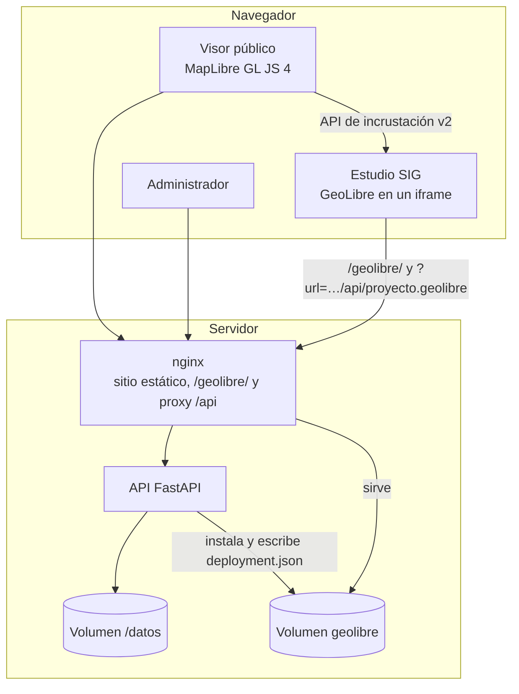

# Arquitectura y despliegue

## Por qué GeoLibre como base

[GeoLibre](https://github.com/opengeos/GeoLibre) es un SIG web libre (MIT) que
lee formatos abiertos y nativos de la nube (GeoJSON, COG, GeoParquet, PMTiles…),
corre el análisis en el navegador y guarda los mapas como proyectos abiertos
`.geolibre`. Lo que **no** hace es alojar ni catalogar datos: «lee los datos de
donde se le indique». El geoportal cubre esa parte:

- un **catálogo administrado** con roles, metadatos y flujo de publicación;
- la **ingesta** que convierte lo que produce la Secretaría (Shapefile en
  MAGNA-SIRGAS, GeoPackage, KML, rásteres) en formatos que GeoLibre y la web
  consumen directamente;
- la **generación de proyectos GeoLibre** a partir del catálogo.

GeoLibre se usa sin modificar su código: su compilación web oficial (la que publica
en PyPI, verificada con SHA-256) se sirve en `geolibre/` del propio geoportal como
**Estudio SIG**, y se configura con sus mecanismos oficiales (`deployment.json` y
`?settingsUrl=`). Las actualizaciones se adoptan cambiando la versión fijada en
`portal/api/geolibre-version.json`. Ver [Estudio SIG](estudio-sig.md).

## Ediciones

El repositorio tiene dos backends con el mismo contrato de API. El sitio estático de `portal/`
(visor, catálogo y administrador) funciona con cualquiera de los dos y detecta la edición con
`GET /api/config` (`edicion`, `ingesta`).

| | Edición Docker (`api/`, Python) | Edición Plesk (`portal/api/`, PHP) |
| --- | --- | --- |
| Ingesta | En el servidor con GDAL (geopandas, rasterio) | En el navegador (`assets/js/ingesta-navegador.js`: shpjs, proj4, togeojson, JSZip, sql.js, geotiff.js) y validación en el servidor |
| Base de datos | SQLAlchemy: SQLite, MySQL, PostgreSQL | PDO MySQL / MariaDB, con prefijo de tablas |
| Instalación | Variables de entorno | Asistente `instalar/` → `config.php` + tabla `opciones` |
| Archivos | `api/app/` | `portal/api/index.php`, `portal/api/lib/*.php`, `portal/instalar/index.php` |

Las librerías del navegador están en `portal/assets/vendor/`, con sus licencias en `licencias/`.
Solo se cargan en el administrador y cuando se necesitan.

## Componentes



| Servicio | Imagen | Puerto | Función |
| --- | --- | --- | --- |
| `web` | `nginx:1.27-alpine` | 8080 | Sirve `portal/`, el Estudio SIG en `/geolibre/` (volumen `geolibre`) y hace proxy de `/api/` |
| `api` | `./api` (Python 3.12) | interno 8000 | Ingesta, catálogo, datos, autenticación, proyectos, instalación y política de GeoLibre |
| `geolibre` (perfil `geolibre-separado`) | `ghcr.io/opengeos/geolibre` | 8081 | Opcional: GeoLibre en su propio origen, con *sidecar* de Python |

### Almacenamiento (volumen `geodatos` → `/datos`)

```
/datos/
├── geoportal.db          # SQLite: capas, categorías, usuarios, bitácora
├── originales/<id>/      # archivo tal como se cargó (descarga «original»)
├── procesados/<id>/      # datos.geojson | datos.tif + vista_previa.png
└── tmp/                  # área de trabajo de la ingesta
```

Para PostgreSQL defina `GEOPORTAL_DATABASE_URL=postgresql+psycopg://…`; las
tablas se crean al iniciar.

### API

Documentación interactiva en `/api/docs`.

**Pública (solo capas publicadas):**

| Método y ruta | Descripción |
| --- | --- |
| `GET /api/config` | Parámetros del visor, URL de GeoLibre y estado del Estudio SIG |
| `GET /api/geolibre/deployment.json` · `ajustes.json` | Política de despliegue y archivo de interfaz del Estudio |
| `GET /api/categorias` | Categorías con capas publicadas |
| `GET /api/capas?q=&categoria=&tipo=` | Catálogo con búsqueda |
| `GET /api/capas/{slug}` | Ficha de la capa |
| `GET /api/capas/{slug}/datos.geojson` | Datos vectoriales (EPSG:4326) |
| `GET /api/capas/{slug}/datos.tif` | COG, con soporte de `Range` |
| `GET /api/capas/{slug}/vista-previa.png` | Vista previa del ráster |
| `GET /api/capas/{slug}/descarga[?original=1]` | Descarga |
| `GET /api/capas/{slug}/proyecto.geolibre` | Proyecto GeoLibre de una capa |
| `GET /api/proyecto.geolibre[?categoria=&capas=a,b&base=]` | Proyecto GeoLibre del catálogo |

**Administración (token Bearer):** `POST /api/auth/ingresar`, `GET /api/auth/yo`,
`POST /api/auth/cambiar-clave`, y bajo `/api/admin/`: `geolibre` (GET/PUT, solo
administradores), `geolibre/instalar` (POST), `resumen`, `capas` (CRUD,
`POST capas` multipart con `archivo` + `metadatos` JSON, `POST capas/{id}/archivo`,
`POST capas/{id}/publicacion?publicar=`, `GET capas/{id}/muestra`),
`categorias`, `usuarios`, `bitacora`.

### Proyectos GeoLibre generados

`api/app/services/geolibre.py` arma el proyecto según el esquema
[`project-format`](https://github.com/opengeos/GeoLibre/blob/main/docs/project-format.md):

- cada **categoría** → carpeta (`layerGroups`), en el orden definido en el
  administrador;
- **vector** → capa `geojson`; hasta `GEOPORTAL_INLINE_MAX_MB` (15 MB) las
  entidades van embebidas en el proyecto (abre sin peticiones extra) y además
  conserva `source.url`; por encima se referencia por URL;
- **ráster** → capa `cog` con la rampa y el reescalado elegidos;
- simbología → `style`; ventana emergente → `popup`; ficha →
  `descriptiveMetadata` (GeoLibre la muestra en *Metadata* y la exporta como
  STAC); `capabilities.export` refleja «permitir descarga»;
- los identificadores son deterministas (UUID v5 del slug, expuestos como
  `geolibre_id` en `/api/capas`), así un proyecto guardado sigue reconociendo sus
  capas y el visor las controla en el Estudio con la API de incrustación;
- `?base=calles|claro|oscuro|fiord|brillante` elige el mapa base del proyecto;
- en la edición PHP, un ráster cuyo GeoTIFF publicado no está teselado o no está en
  EPSG:4326/3857 entra como imagen georreferenciada (vista previa PNG).

El Estudio SIG abre `geolibre/?url=<proyecto>&settingsUrl=geolibre/geoportal-ajustes.json`
con `locale`, `theme` (claro u oscuro, el del portal), `lat`/`lon`/`zoom` y, en modo
visor, `layout=viewer`. Con una instancia externa se usa `?url=<proyecto>&welcome=0`.

### Estudio SIG

| Pieza | Edición PHP | Edición Python/Docker |
| --- | --- | --- |
| Ajustes | Opción `geolibre` (JSON) en la tabla `opciones` | `geolibre-ajustes.json` en el volumen de datos |
| Política y archivo de interfaz | `geolibre/deployment.json`, `geolibre/geoportal-ajustes.json` (y `/api/geolibre/deployment.json`) | Igual, en el volumen `geolibre` |
| Instalación | `gl_instalar()` en `portal/api/lib/geolibre.php` | `estudio.instalar()` en `api/app/services/estudio.py` |
| Integrado o externo | Opción `geolibre_url` (`local` o URL) y `geolibre_url_externa` | `GEOLIBRE_PUBLIC_URL` y `geolibre-url*.txt` en el volumen de datos |
| Rutas | `GET/PUT /api/admin/geolibre`, `POST /api/admin/geolibre/instalar` | Iguales |

`sharing.embedOrigins` contiene el origen público del portal y sus variantes
`http`/`https` y con o sin `www.`. Si GeoLibre se copió a mano y trae el
`deployment.json` vacío del paquete, `/api/config` genera el del geoportal.

## Despliegue en producción

1. Servidor Linux con Docker y Docker Compose.
2. Un nombre DNS con TLS, por ejemplo `geoportal-ambiental.narino.gov.co` → puerto 8080
   (el Estudio SIG queda en `/geolibre/` del mismo origen).
3. `.env`:

   ```ini
   GEOPORTAL_PUBLIC_URL=https://geoportal-ambiental.narino.gov.co
   GEOLIBRE_PUBLIC_URL=local
   GEOPORTAL_SECRET_KEY=<openssl rand -base64 48>
   GEOPORTAL_ADMIN_PASSWORD=<clave fuerte>
   GEOPORTAL_API_DOCS=false
   ```

4. `docker compose up -d --build`.
5. Proxy inverso con TLS delante (nginx/Caddy/Traefik institucional). Ajuste
   `client_max_body_size` y los tiempos de espera si cambia el límite de carga.
6. *Administrador → Estudio SIG → Instalar GeoLibre* (la API necesita salida HTTPS hacia
   `files.pythonhosted.org`; el archivo queda en el volumen `geolibre`).

Requisitos de GeoLibre:

- su política de seguridad (CSP) solo permite conectarse a orígenes `https:` (más
  `localhost`), por lo que una **instancia externa** exige el geoportal en HTTPS; el
  Estudio integrado comparte origen y no tiene esa restricción, pero HTTPS se recomienda
  igual;
- una instancia externa descarga proyecto y datos desde otro origen: la API responde con
  CORS para su origen (configurable en caliente desde el administrador) y expone
  `Content-Range`/`Accept-Ranges` para los GeoTIFF.

### Configuración de GeoLibre

Toda la política se edita en *Administrador → Estudio SIG* (marca, idioma, acento, modo,
nivel de interfaz y menús, permisos, complementos, catálogo de servicios, compartir,
colaboración, Overpass y GeoLens); ver la tabla completa en
[Estudio SIG](estudio-sig.md#configuración-administrador--estudio-sig). El servicio
separado `geolibre` del `docker-compose.yml` (imagen oficial, con *sidecar* de Python
opcional) queda en el perfil `geolibre-separado` y usa `geolibre/deployment.json` del
repositorio. Ver
[self-hosting](https://github.com/opengeos/GeoLibre/blob/main/docs/self-hosting.md)
y [deployment-policy](https://github.com/opengeos/GeoLibre/blob/main/docs/deployment-policy.md).

### Respaldos

Respalde el volumen completo (base de datos y archivos):

```bash
docker run --rm -v app-ambiente_geodatos:/datos -v "$PWD":/respaldo alpine tar czf /respaldo/geodatos-$(date +%F).tar.gz -C /datos .
```

Con SQLite, haga el respaldo con el servicio `api` detenido o use
`sqlite3 geoportal.db ".backup respaldo.db"`.

### Seguridad

- Contraseñas con bcrypt; sesiones JWT HS256 firmadas con `GEOPORTAL_SECRET_KEY`.
- Roles editor/administrador validados en el servidor; bitácora de acciones.
- La API pública solo sirve capas publicadas; el administrador accede a borradores.
- Ingesta protegida contra *zip-slip* y bombas de descompresión; límite de tamaño.
- `/admin/` se sirve con `noindex`, `no-store` y `X-Frame-Options: DENY`.
- Recomendado: restringir `/admin/` y `/api/admin/` por red (VPN o IP
  institucionales) en el proxy perimetral.

## Pruebas

```bash
cd api && pip install -r requirements-dev.txt && python -m pytest
```

Cubren la ingesta (GeoJSON, Shapefile en EPSG:9377, Shapefile sin `.prj`, CSV con
decimales con coma, ráster → COG, formatos no válidos, *zip-slip*) y la API
(autenticación, roles, carga, publicación, catálogo, proyecto GeoLibre, peticiones
por rangos, reemplazo, eliminación, bitácora).
